<div align="center">



<p>
  
  
  
  
  
  <a href="https://github.com/jf-floresriera/git_hub_introduction/actions/workflows/verificar.yml"></a>
</p>


</div>


# Resumen

Material de apoyo para una **presentación de introducción a GitHub**: qué es la plataforma, para qué sirve, por qué vale la
pena usarla y cómo se trabaja con ella desde **el navegador**, **el escritorio** y **la terminal** en **Windows** y **Linux**.

| Recurso | Dónde |
|---|---|
| Presentación (diapositivas) | [Ver presentación](PRESENTACION.md) |
| Guía rápida de comandos | [`docs/comandos.md`](docs/comandos.md) |
| Instalación en Windows y Linux | [`docs/instalacion.md`](docs/instalacion.md) |
| Trabajar desde el navegador | [`docs/navegador.md`](docs/navegador.md) |
| Trabajar desde el escritorio (GitHub Desktop y VS Code) | [`docs/escritorio.md`](docs/escritorio.md) |
| Servicios de la plataforma | [`docs/servicios.md`](docs/servicios.md) |
| Glosario | [`docs/glosario.md`](docs/glosario.md) |
| Prácticas guiadas | [`ejercicios/`](ejercicios/) |
| Scripts de configuración inicial | [`scripts/`](scripts/) |


# Qué es GitHub

**Git** es un programa que guarda la historia de un proyecto: cada vez que confirmas un cambio (un *commit*), Git registra
qué cambió, quién lo hizo, cuándo y por qué. Funciona en tu computador y no necesita internet.

**GitHub** es una plataforma en la nube que aloja repositorios de Git y agrega todo lo necesario para **trabajar en equipo**:
revisión de cambios, seguimiento de tareas, automatización, publicación de sitios web y entornos de desarrollo en el
navegador.

| | Git | GitHub |
|---|---|---|
| Qué es | Programa de control de versiones | Servicio web que aloja repositorios Git |
| Dónde corre | En tu equipo | En la nube (navegador, app y API) |
| Creado | 2005, por Linus Torvalds | 2008; de Microsoft desde 2018 |
| Necesita internet | No | Sí, para sincronizar |
| Alternativas | Mercurial, SVN | GitLab, Bitbucket, Codeberg |

### El ecosistema en cifras

<table align="center">
  <tr>
    <td align="center"><h3>180 M+</h3>desarrolladores</td>
    <td align="center"><h3>630 M</h3>repositorios<br><sub>63 % públicos</sub></td>
    <td align="center"><h3>~1</h3>persona nueva<br>por segundo</td>
    <td align="center"><h3>43,2 M</h3>pull requests<br>integrados al mes</td>
    <td align="center"><h3>~1000 M</h3>commits<br>en 2025</td>
  </tr>
</table>

<p align="center"><sub>Fuente: GitHub, <a href="https://github.blog/news-insights/octoverse/octoverse-a-new-developer-joins-github-every-second-as-ai-leads-typescript-to-1/">Octoverse 2025</a> (septiembre 2024 a agosto 2025).</sub></p>


# Usos y potencialidades

| Uso | Ejemplo concreto |
|---|---|
| Guardar versiones de código, scripts y documentos | Volver a la versión del script que funcionaba la semana pasada |
| Trabajar en equipo sin pisarse | Cada persona en su rama; los cambios se revisan antes de integrarse |
| Ciencia abierta y reproducible | Publicar el código de una tesis o artículo, con DOI a través de Zenodo y un archivo `CITATION.cff` |
| Portafolio profesional | El perfil muestra proyectos reales a empleadores y colaboradores |
| Automatizar tareas | Correr pruebas o generar figuras en cada cambio con GitHub Actions |
| Publicar sitios web gratis | Página personal, documentación o un curso con GitHub Pages |
| Gestionar proyectos | Issues para tareas y errores, Projects como tablero |
| Aprender de otros | Leer, copiar (*fork*) y mejorar millones de proyectos abiertos |

**Por qué vale la pena usarlo**

1. **Nunca se pierde trabajo**: todo queda en el historial y respaldado en la nube.
2. **Se sabe quién cambió qué y por qué**: cada commit lleva autor, fecha y mensaje.
3. **Se puede experimentar sin miedo**: una rama es una copia segura para probar ideas.
4. **Es el estándar de la industria y la academia**: lo usan empresas, universidades y revistas científicas.
5. **El plan gratuito alcanza para casi todo**: repositorios públicos y privados ilimitados.


# Cómo funciona Git

<div align="center"></div>

Un cambio pasa por cuatro lugares:

1. **Directorio de trabajo**: editas tus archivos como siempre.
2. **Área de preparación** (*staging*): con `git add` eliges qué cambios irán en la próxima versión.
3. **Repositorio local**: con `git commit` guardas esa versión en el historial, con un mensaje.
4. **Repositorio remoto** (GitHub): con `git push` subes tus commits; con `git pull` traes los de los demás.


# Tres formas de trabajar

| | Navegador | Escritorio | Terminal |
|---|---|---|---|
| Herramienta | github.com | GitHub Desktop, VS Code | Git + GitHub CLI (`gh`) |
| Instalar algo | No | Sí | Sí |
| Ideal para | Empezar, revisar, editar un archivo, issues y PR | Quien prefiere botones a comandos | Control total, automatizar, servidores |
| Windows | Sí | Sí | PowerShell, Git Bash, Windows Terminal |
| Linux | Sí | VS Code; GitHub Desktop solo por versión comunitaria | bash, zsh |

<details open>
<summary><b>1 · Desde el navegador</b></summary>

<br>

1. Crear la cuenta en [github.com/signup](https://github.com/signup) (con el correo institucional se puede solicitar
   [GitHub Education](https://education.github.com/)).
2. Botón **New** → nombre del repositorio → marcar **Add a README file** → **Create repository**.
3. **Add file → Upload files** para subir archivos arrastrándolos; escribir un mensaje y **Commit changes**.
4. Para editar un archivo: abrirlo y pulsar el lápiz. Para editar varios a la vez: pulsar la tecla <kbd>.</kbd> dentro del
   repositorio; se abre un editor completo (github.dev).
5. **Issues** para anotar tareas, **Pull requests** para proponer y revisar cambios, **Settings → Pages** para publicar un sitio.

Guía completa: [`docs/navegador.md`](docs/navegador.md).
</details>

<details>
<summary><b>2 · Desde el escritorio</b></summary>

<br>

- **GitHub Desktop** (Windows y macOS): clonar, ver cambios, hacer commit, cambiar de rama y sincronizar con botones.
  En Linux no hay versión oficial; existe una versión comunitaria (*shiftkey/desktop*).
- **Visual Studio Code** (Windows, Linux y macOS): panel **Source Control** integrado, con extensión
  *GitHub Pull Requests* para revisar PR sin salir del editor.

Guía completa: [`docs/escritorio.md`](docs/escritorio.md).
</details>

<details>
<summary><b>3 · Desde la terminal</b></summary>

<br>

**Instalar**

```powershell
# Windows (PowerShell)
winget install --id Git.Git -e --source winget
winget install --id GitHub.cli -e
```

```bash
# Linux
sudo apt install git gh        # Debian, Ubuntu, Mint
sudo dnf install git gh        # Fedora
sudo pacman -S git github-cli  # Arch, Manjaro
```

**Configurar una sola vez** (igual en Windows y Linux)

```bash
git config --global user.name "Tu Nombre"
git config --global user.email "tu_correo@unal.edu.co"
git config --global init.defaultBranch main
gh auth login          # inicia sesión en GitHub desde la terminal
```

> [!IMPORTANT]
> Desde 2021 GitHub **no acepta la contraseña de la cuenta** para `git push`. Usa `gh auth login`, el administrador de
> credenciales que trae Git para Windows, un *token* personal o una llave SSH. Detalles en [`docs/instalacion.md`](docs/instalacion.md).

Guía completa: [`docs/instalacion.md`](docs/instalacion.md). Script listo: [`scripts/configurar_git.ps1`](scripts/configurar_git.ps1) (Windows) y [`scripts/configurar_git.sh`](scripts/configurar_git.sh) (Linux).
</details>


# Primer repositorio, paso a paso

<div align="center"></div>

**Opción A: el repositorio ya existe en GitHub** (lo más sencillo)

```bash
git clone https://github.com/USUARIO/mi-proyecto.git
cd mi-proyecto
# ... crear o editar archivos ...
git status
git add .
git commit -m "Primer cambio"
git push
```

**Opción B: tengo una carpeta en mi equipo y quiero subirla**

```bash
cd mi-carpeta
git init
git add .
git commit -m "Primera versión"
gh repo create mi-proyecto --public --source=. --push
```

Sin `gh`, se crea el repositorio vacío en github.com y luego:

```bash
git remote add origin https://github.com/USUARIO/mi-proyecto.git
git push -u origin main
```


# Ramas y pull requests

<div align="center"></div>

```bash
git switch -c mi-rama              # crear la rama y pasarse a ella
# ... cambios ...
git add .
git commit -m "Describe el cambio"
git push -u origin mi-rama         # subir la rama
gh pr create --fill                # abrir el pull request (o desde la web)
# después de revisar y aprobar en GitHub:
git switch main
git pull                           # traer main actualizado
git branch -d mi-rama              # borrar la rama local
```


# Comandos principales

| Para... | Comando |
|---|---|
| Ver la versión instalada | `git --version` |
| Crear un repositorio en la carpeta actual | `git init` |
| Copiar un repositorio de GitHub | `git clone URL` |
| Ver qué cambió | `git status` · `git diff` |
| Preparar cambios | `git add archivo` · `git add .` |
| Guardar una versión | `git commit -m "mensaje"` |
| Ver el historial | `git log --oneline --graph` |
| Subir cambios | `git push` |
| Traer cambios | `git pull` · `git fetch` |
| Ver y crear ramas | `git branch` · `git switch -c nombre` |
| Cambiar de rama | `git switch nombre` |
| Unir una rama a la actual | `git merge nombre` |
| Ver los remotos | `git remote -v` |
| Descartar cambios de un archivo | `git restore archivo` |
| Sacar un archivo del staging | `git restore --staged archivo` |
| Deshacer un commit ya subido (sin borrar historia) | `git revert ID` |
| Guardar cambios temporalmente | `git stash` · `git stash pop` |
| Marcar una versión | `git tag v1.0` · `git push --tags` |

Guía completa, por categorías: [`docs/comandos.md`](docs/comandos.md).

<details>
<summary><b>Windows y Linux: lo que cambia</b></summary>

<br>

Los comandos de **Git son idénticos** en ambos sistemas. Cambian la terminal y algunos comandos del sistema:

| | Windows (PowerShell) | Linux (bash) |
|---|---|---|
| Listar archivos | `dir` o `ls` | `ls -la` |
| Ir a una carpeta | `cd C:\Users\yo\proyectos` | `cd ~/proyectos` |
| Crear archivo vacío | `New-Item archivo.txt` | `touch archivo.txt` |
| Crear carpeta | `mkdir datos` | `mkdir -p datos` |
| Ver un archivo | `Get-Content archivo.txt` | `cat archivo.txt` |
| Separador de rutas | `\` | `/` |
| Fin de línea en archivos | CRLF → `git config --global core.autocrlf true` | LF → `git config --global core.autocrlf input` |
| Credenciales | Git Credential Manager (incluido) | `gh auth login` o llave SSH |

En Windows, **Git Bash** (se instala con Git) acepta los mismos comandos que Linux.
</details>


# Servicios de la plataforma

<div align="center"></div>

| Servicio | Para qué | Plan gratuito (cuenta personal) |
|---|---|---|
| Repositorios | Alojar código e historial | Públicos y privados ilimitados |
| Issues y Projects | Tareas, errores y tableros | Incluido |
| Pull requests | Proponer y revisar cambios | Incluido |
| Actions | Automatizar pruebas y despliegues | Ilimitado en repos públicos; 2000 min/mes en privados |
| Pages | Sitios web estáticos | En repositorios públicos |
| Codespaces | Entorno de desarrollo en la nube | 120 horas-núcleo y 15 GB al mes |
| Packages | Publicar paquetes y contenedores | 500 MB |
| Copilot | Asistente de programación | Plan gratuito con límites mensuales |
| Dependabot | Alertas de dependencias vulnerables | Incluido |
| Releases y Zenodo | Versiones descargables y DOI para citar | Incluido |

Cuotas según la [documentación de planes de GitHub](https://docs.github.com/es/get-started/learning-about-github/githubs-plans), consultada en octubre de 2026. Este mismo repositorio usa **Actions**: [`verificar.yml`](.github/workflows/verificar.yml) revisa en cada push que las figuras y el ejemplo funcionen.

Más detalle: [`docs/servicios.md`](docs/servicios.md).


# Errores frecuentes

| Mensaje o situación | Qué pasa | Solución |
|---|---|---|
| `Support for password authentication was removed` | Se intentó usar la contraseña de la cuenta | `gh auth login`, token personal o SSH |
| `! [rejected] ... (fetch first)` | Hay commits en GitHub que no tienes | `git pull` y luego `git push` |
| `CONFLICT (content): Merge conflict in ...` | Dos personas cambiaron las mismas líneas | Editar el archivo, elegir el contenido, `git add` y `git commit` |
| `fatal: not a git repository` | La terminal no está en la carpeta del proyecto | `cd` a la carpeta correcta o `git init` |
| `File ... exceeds GitHub's file size limit of 100.00 MB` | Archivo demasiado grande | Agregarlo a `.gitignore` o usar Git LFS |
| Se subió una contraseña o llave | Queda en el historial aunque se borre | Revocarla de inmediato y crear una nueva |

> [!TIP]
> Un archivo [`.gitignore`](ejemplos/.gitignore) evita subir datos pesados, entornos virtuales y credenciales. En proyectos
> con rásters, imágenes de dron o bases de datos, versiona el **código** y publica los **datos** en un repositorio de datos
> (Zenodo, Figshare o el institucional).


# Prácticas guiadas

| Práctica | Qué se aprende | Tiempo |
|---|---|---|
| [`01_primer_repositorio.md`](ejercicios/01_primer_repositorio.md) | Crear un repo en la web, clonarlo, commit y push | 20 min |
| [`02_ramas_y_pull_request.md`](ejercicios/02_ramas_y_pull_request.md) | Rama, pull request, revisión y merge | 25 min |
| [`03_colaborar_con_fork.md`](ejercicios/03_colaborar_con_fork.md) | Fork y aporte a un proyecto ajeno | 20 min |
| [`04_github_pages.md`](ejercicios/04_github_pages.md) | Publicar una página web | 15 min |


# Estructura del repositorio

```text
git_hub_introduction/
├── README.md                 esta guía
├── PRESENTACION.md           enlace y guion de la presentación
├── docs/                     guías por tema (comandos, instalación, navegador, escritorio, servicios, glosario)
├── ejercicios/               prácticas guiadas para la sesión
├── ejemplos/
│   ├── hola_github.py        script de ejemplo para el primer commit
│   ├── .gitignore            plantilla comentada
│   └── pagina/index.html     página mínima para GitHub Pages
├── scripts/
│   ├── configurar_git.ps1    configuración inicial en Windows
│   ├── configurar_git.sh     configuración inicial en Linux
│   └── generar_svgs.py       genera las figuras animadas de este README
├── assets/readme/            banner, diagramas y animaciones (SVG)
└── .github/workflows/        automatización con GitHub Actions
```

Las figuras animadas son SVG generados con [`scripts/generar_svgs.py`](scripts/generar_svgs.py) (`python scripts/generar_svgs.py`).


# Autor

**Jesús Enrique Flores Riera**, candidato a Maestría en Geomática, Universidad Nacional de Colombia
([jfloresr@unal.edu.co](mailto:jfloresr@unal.edu.co)).

### Nota sobre el uso de inteligencia artificial

Se usaron herramientas de inteligencia artificial generativa como apoyo para redactar la documentación, organizar el
repositorio y generar las figuras. El contenido fue revisado por el autor, que es responsable de él. Las herramientas de IA
no figuran como autoras.

### Licencia

Textos y figuras: [CC BY 4.0](https://creativecommons.org/licenses/by/4.0/deed.es). Código de ejemplo y scripts: [MIT](LICENSE).
GitHub y Git son marcas de sus respectivos titulares; este material es independiente y con fines educativos.

<div align="center">
<br>

<br><br>

<br><sub>Jesús Enrique Flores Riera · Universidad Nacional de Colombia</sub>
</div>
